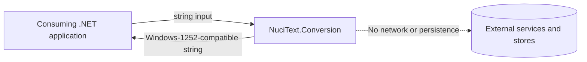
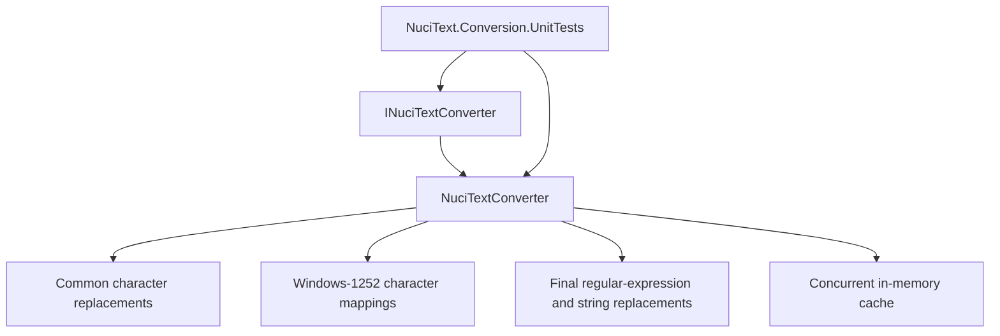
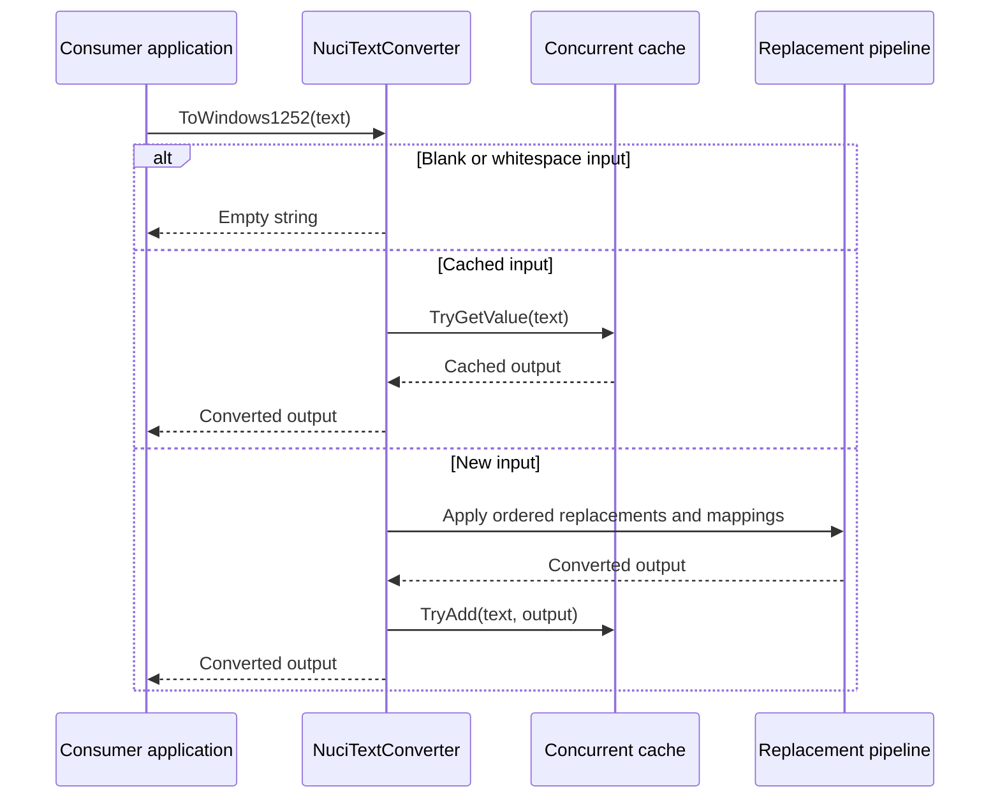
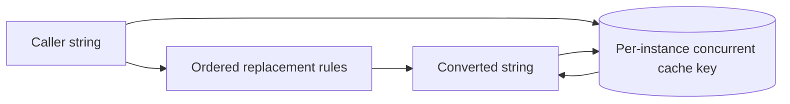

# NuciText.Conversion Architecture

This document describes the current architecture of the NuciText.Conversion .NET library and its unit-test project. It records the public contract, text-conversion pipeline, cache, dependency boundaries, and verification approach.

## 📑 Table of Contents

- [Purpose](#purpose)
- [System Context](#system-context)
- [Architectural Style](#architectural-style)
- [Runtime Flow](#runtime-flow)
- [Components](#components)
- [Architectural Areas](#architectural-areas)
  - [Conversion Library](#conversion-library)
  - [Unit Tests](#unit-tests)
- [Data Architecture](#data-architecture)
- [Interfaces and Integrations](#interfaces-and-integrations)
- [Cross-Cutting Concerns](#cross-cutting-concerns)
  - [Security and Privacy](#security-and-privacy)
  - [Error Handling](#error-handling)
  - [Concurrency and Resource Use](#concurrency-and-resource-use)
- [Dependency Direction and Rules](#dependency-direction-and-rules)
- [External Dependencies](#external-dependencies)
- [Deployment and Operations](#deployment-and-operations)
- [Compatibility Contracts](#compatibility-contracts)
- [Testing and Verification](#testing-and-verification)
- [Design Constraints](#design-constraints)
- [Extension Points](#extension-points)
  - [Text Converter Contract](#text-converter-contract)
- [Source Map](#source-map)
- [Related Documentation](#related-documentation)

## 🎯 Purpose

NuciText.Conversion converts text containing characters outside the Windows-1252 character set into text suitable for that character set. This document is for maintainers and contributors who need to understand ownership, execution order, public contracts, and change-sensitive behaviour. It describes the current implementation, not a proposed target architecture.

## 🌐 System Context

The library is an in-process component. A consuming .NET application supplies a string through the public converter contract and receives a converted string. The library does not host a process, expose a network endpoint, access a database, or call external services.



The principal external boundaries are:
- **Consumer application:** Owns the input string, converter lifetime, output handling, and any persistence or transmission performed after conversion.
- **Runtime libraries:** Provide dictionaries, regular expressions, string operations, concurrent caching, and collection types used by the converter.
- **External services and stores:** No interaction is implemented by the library.

## 🏗️ Architectural Style

The repository uses a small library architecture with a public interface, one sealed implementation, a deterministic in-memory transformation pipeline, and a separate NUnit unit-test project. The implementation is synchronous and in-process. The main consequence is that consumers own composition and operational concerns while the library owns conversion rules and its local cache.



The principal architecture boundaries are:
- **Public contract:** `INuciTextConverter` defines the conversion operation exposed to consumers.
- **Conversion implementation:** `NuciTextConverter` owns ordered replacements, mapping tables, and cache access.
- **Verification:** `NuciText.Conversion.UnitTests` verifies observable conversion results and output character restrictions.

## 🔄 Runtime Flow



The principal runtime sequence is:
1. The consumer calls `ToWindows1252` with a string.
2. Blank or whitespace-only input returns an empty string.
3. The converter checks its concurrent cache for the original input.
4. For uncached input, the converter applies special replacements, common mappings, Windows-1252 mappings, regular expressions, and final replacements in order.
5. The converter adds the result to the cache and returns it.

## 🧩 Components

| Component | Responsibility | Principal Dependencies | Lifetime or Ownership |
|-----------|----------------|------------------------|-----------------------|
| `INuciTextConverter` | Defines the public text-conversion contract. | None | Owned and selected by the consumer. |
| `NuciTextConverter` | Executes the conversion pipeline and owns mapping tables and cache access. | `ConcurrentDictionary`, `Dictionary`, `Regex`, `StringBuilder` | Instantiated by the consumer; cache lifetime is the instance lifetime. |
| `NuciText.Conversion.UnitTests` | Exercises conversion examples and verifies the output character set. | NUnit, LINQ, production project reference | Test process and test fixture lifetime. |

## 🗂️ Architectural Areas

### Conversion Library

Paths:
- `NuciText.Conversion/INuciTextConverter.cs`
- `NuciText.Conversion/NuciTextConverter.cs`
- `NuciText.Conversion/NuciText.Conversion.csproj`

Responsibilities:
- Expose the text-conversion contract.
- Apply ordered character mappings and normalisation rules.
- Cache converted results in memory.

Boundary rules:
- The library remains in-process and synchronous.
- Consumer-owned storage, networking, logging, and application composition remain outside this area.
- Public conversion behaviour is owned by the interface and implementation together.

### Unit Tests

Paths:
- `NuciText.Conversion.UnitTests/NuciTextConverterTests.cs`
- `NuciText.Conversion.UnitTests/NuciText.Conversion.UnitTests.csproj`

Responsibilities:
- Verify representative transliteration and Windows-1252 conversion cases.
- Verify that output does not contain characters outside the declared Windows-1252 character set.

Boundary rules:
- Tests consume the production project through its public API.
- Tests do not define production runtime behaviour or add production-only dependencies.

## 💾 Data Architecture

The library transforms caller-provided strings and does not persist them. `NuciTextConverter` keeps two in-memory character-mapping dictionaries and one per-instance concurrent result cache. The cache is keyed by the original input and stores the final converted string; it has no configured expiry or persistence mechanism.



| Data or Store | Owner | Representation and Storage | Lifecycle or Consistency |
|---------------|-------|----------------------------|--------------------------|
| Common character mappings | `NuciTextConverter` | In-memory `Dictionary<char, string>` | Initialised with the converter instance and not mutated during conversion. |
| Windows-1252 mappings | `NuciTextConverter` | In-memory `Dictionary<char, string>` | Initialised with the converter instance and not mutated during conversion. |
| Conversion result cache | `NuciTextConverter` | In-memory `ConcurrentDictionary<string, string>` | Lives for the converter instance; entries are added for inputs and are not persisted or expired. |

## 🔌 Interfaces and Integrations

| Interface or Integration | Direction | Contract | Owner | Failure Semantics |
|--------------------------|-----------|----------|-------|-------------------|
| `INuciTextConverter.ToWindows1252` | Inbound and return value | Synchronous C# method accepting and returning `string` | NuciText.Conversion | Returns an empty string for blank input; otherwise returns the transformed string. |

The library has no built-in external integrations. NuGet distribution is a packaging concern rather than a runtime integration.

## 🧵 Cross-Cutting Concerns

### Security and Privacy

The library performs in-memory processing and has no network, database, telemetry, or logging integration. It does not authenticate callers or authorise operations. Consumers are responsible for protecting input and output strings if they contain sensitive data, as well as for any persistence or transmission around the library.

### Error Handling

The public conversion method has an explicit blank-input path. The conversion pipeline otherwise consists of synchronous string, mapping, and regular-expression operations; no retry, remote failure, or process-level recovery mechanism is implemented by the library. Exceptions from the runtime or invalid consumer usage are not translated by a separate application boundary.

### Concurrency and Resource Use

Conversion calls are synchronous. The result cache uses `ConcurrentDictionary` so concurrent access to a converter instance can safely perform cache operations. Mapping dictionaries are read during conversion and are not intended to be mutated. Cache growth is unbounded for the lifetime of a converter instance, so consumers control instance lifetime when input cardinality is high.

## 🧭 Dependency Direction and Rules

The production project has no project dependency on the test project. The test project references the production project and uses its public contract. Within production, the public interface is implemented by the converter; runtime collection, regular-expression, text, and concurrent-cache functionality is supplied by the .NET runtime.


The principal dependency rules are:
- The unit-test project may depend on the production project; the production project must not depend on tests.
- Consumers depend on the public `INuciTextConverter` contract rather than relying on internal implementation details.
- The library does not depend on persistence, networking, application hosts, or external service adapters.

## 📦 External Dependencies

| Dependency | Responsibility | Integration Boundary | Architectural Consequence |
|------------|----------------|-----------------------|---------------------------|
| .NET 10.0 runtime libraries | Provide collections, regular expressions, string processing, and concurrent access primitives. | `NuciTextConverter` implementation | The library targets the .NET 10.0 runtime and remains synchronous and in-process. |
| NUnit 4.5.0 | Provide unit-test attributes and assertions. | `NuciText.Conversion.UnitTests` | Test execution depends on the NUnit toolchain; production code does not. |
| Microsoft.NET.Test.Sdk 18.3.0 | Provide test execution integration. | `NuciText.Conversion.UnitTests` | CI and local test execution use the .NET test SDK. |

## 🚀 Deployment and Operations

NuciText.Conversion is distributed as a .NET library through NuGet and is loaded into the consuming application's process. It has no standalone process topology, network listener, database, filesystem store, or service shutdown sequence. The consumer controls package selection, converter lifetime, memory limits, and any operational handling around the library.

| Concern | Current Design | Architectural Consequence |
|---------|----------------|---------------------------|
| Process topology | In-process library | No independent service deployment or health endpoint exists. |
| Persistent state | None in the library | Consumers own persistence, backups, and deletion of any surrounding data. |
| Scaling | Consumer-controlled instances and calls | Horizontal or parallel scaling is a property of the host application. |
| Distribution | NuGet package | Package version selection is the consumer's responsibility. |

## 🛡️ Compatibility Contracts

| Contract | Owner | Invariant | Verification | Change Policy |
|----------|-------|-----------|--------------|---------------|
| `INuciTextConverter` | Conversion library | `ToWindows1252(string)` remains available with its current synchronous return contract. | Compilation and unit tests. | Preserve the public API or make an intentional breaking release. |
| Conversion mappings | `NuciTextConverter` | Supported input characters produce the expected Windows-1252-compatible output. | Parameterised unit tests in `NuciTextConverterTests.cs`. | Revise mappings with regression tests for changed behaviour. |
| Output character constraint | Conversion library | Tested output contains only characters in the declared Windows-1252 character set plus a space. | `WhenNormalisingForWindow1252_ReturnsTheNameWithoutCharsOutsideCharset`. | Preserve or explicitly revise the output contract with tests and documentation. |
| Cache key and result relationship | `NuciTextConverter` | A repeated original input returns the corresponding converted result. | Behavioural tests and implementation review. | Preserve cache semantics unless performance or lifecycle behaviour is intentionally changed. |

## ✅ Testing and Verification

The unit-test project verifies the public converter behaviour with NUnit. Tests cover many character and diacritic cases, blank-input behaviour through the conversion path, and the absence of characters outside the declared output set. The repository does not contain separate architecture tests, integration tests, performance tests, or security tests.

Execute the principal automated verification with:

```bash
dotnet test --no-restore
```

The CI workflow also runs `dotnet restore`, `dotnet build --no-restore`, and `dotnet test --no-build --verbosity normal` on pushes and pull requests targeting `master`.

## ⚠️ Design Constraints

- **In-memory operation:** The library does not persist, transmit, or observe converted data; host applications own those concerns.
- **Ordered replacement semantics:** Conversion rules are applied sequentially, so changing an earlier mapping can alter later matching and final output.
- **Unbounded instance cache:** The cache has no expiry or maximum size; long-lived instances with many distinct inputs can retain increasing memory.
- **Target framework:** Production and test projects target .NET 10.0, so consumers and contributors require a compatible SDK/runtime.
- **Compatibility-sensitive mappings:** Mapping tables contain domain-specific transliteration decisions and must be changed with focused regression coverage.

## 🔧 Extension Points

### Text Converter Contract

1. Implement or revise the `INuciTextConverter` contract.
2. Register or integrate the implementation at the verified composition boundary.
3. Add the verification required to preserve neighbouring contracts.

Implementations must preserve the synchronous `ToWindows1252` method contract, its blank-input behaviour, and the documented output semantics. The current repository provides `NuciTextConverter` as the concrete implementation; consumer composition is outside the repository.

## 🗺️ Source Map

| Area | Path |
|------|------|
| Production contract | `NuciText.Conversion/INuciTextConverter.cs` |
| Production implementation | `NuciText.Conversion/NuciTextConverter.cs` |
| Production project | `NuciText.Conversion/NuciText.Conversion.csproj` |
| Unit tests | `NuciText.Conversion.UnitTests/NuciTextConverterTests.cs` |
| CI validation | `.github/workflows/dotnet.yml` |

## 📚 Related Documentation

- [README.md](./README.md) describes installation, usage, capabilities, contribution guidance, privacy, and security at repository level.
- [PRIVACY.md](./PRIVACY.md) describes the library's data handling and lack of built-in external data transfer.
- [SECURITY.md](./SECURITY.md) describes supported versions and vulnerability reporting.
- [CONTRIBUTING.md](./CONTRIBUTING.md) describes contributor setup and verification commands.
